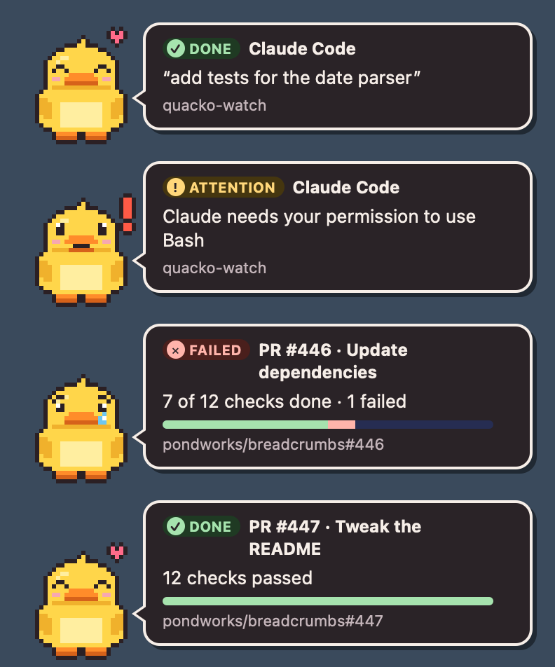
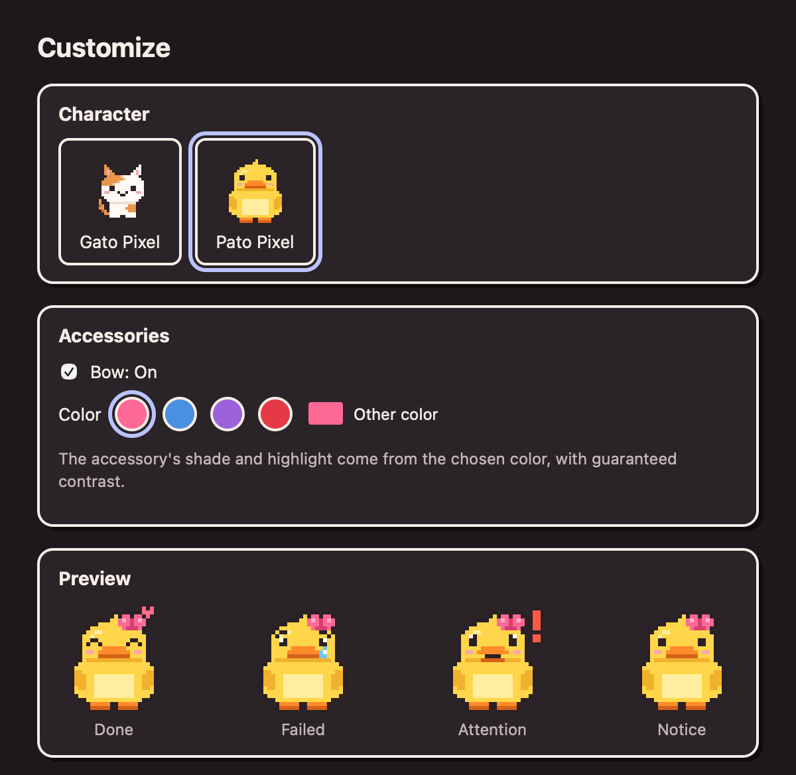

<p align="center">
  
</p>

<h1 align="center">Quacko</h1>

<p align="center">
  <b>A little pixel-art duck that lets you know when the work is done.</b><br>
  Claude Code, Cursor and your PRs' CI, in a tiny card in the corner of your screen.
</p>

<p align="center">
  
  
  
  
  
  <a href="https://github.com/larasouzabr/quacko/actions/workflows/ci.yml"></a>
</p>

<p align="center">
  <a href="https://github.com/larasouzabr/quacko/releases/latest/download/Quacko_universal.dmg"></a>
  <a href="https://github.com/larasouzabr/quacko/releases/latest/download/Quacko_x64-setup.exe"></a>
  <br>
  <sub><a href="https://github.com/larasouzabr/quacko/releases">All versions</a></sub>
</p>

<p align="center">
  
</p>

The duck pops up in the corner of your screen when something finishes: Claude Code or Cursor just answered (or needs you), or a PR's CI passed or failed. Clicking the card opens the PR. It lives only in the menu bar (macOS) or the system tray (Windows), never steals focus from wherever you're typing, and works offline: everything happens on your computer.

| | State | When |
|:-:|---|---|
|  | ✓ **Done** | the agent finished, CI passed |
|  | ✕ **Failed** | CI failed, the agent stopped with an error |
|  | ! **Attention** | the agent needs permission or an answer |
|  | i **Notice** | any other notice |

**Characters:** **Pato Pixel** (the duck) is the default on new installs; **Gato Pixel** (the cat) is still available (the `character` field in the config: `pato-pixel` or `gato-pixel`). With no explicit choice, the duck wins.

**Accessories (optional):** in the duck's menu → **Customize…** you can switch characters and turn on the **bow**, in preset colors (pink, blue, purple, red) or any other; its shade and highlight are derived from the chosen color with guaranteed contrast, and the preview shows all 4 states right away. An accessory is just data: an `accessory.json` and one sprite per state on the same grid as the character. The `~/.config/quacko/accessories/` folder is ready for importing more in the future; importing checks sizes, extensions, real PNGs, links and `..` paths (zip slip).

<p align="center">
  
</p>

## Install

### macOS 11+ (Apple Silicon and Intel)

Click **Download for macOS** at the top of this page (it always fetches the latest version) or build it from source (see [Development](#development)). The universal `.dmg` works on both Apple Silicon and Intel Macs.

1. Open the `.dmg` and drag **Quacko.app** into **Applications**.
2. The build isn't signed by Apple, so macOS blocks the first launch when the `.dmg` was downloaded. Allow it in one of these ways:
   - open Quacko, go to **System Settings → Privacy & Security**, find the notice about Quacko at the bottom of the page and click **Open Anyway**; or
   - in Terminal: `xattr -dr com.apple.quarantine /Applications/Quacko.app`
3. From then on it opens like any other app. The duck shows up in the menu bar (not in the Dock).

Or with [Homebrew](https://brew.sh) (the first launch needs the same **Open Anyway** step):

```bash
brew install --cask larasouzabr/quacko/quacko
```

`brew upgrade --cask quacko` updates it, and `brew uninstall --zap --cask quacko` removes the app with its settings.

### Windows 10 and 11 (x64)

1. Click **Download for Windows** at the top of this page and run the installer. It installs for your user only, with no admin rights needed.
2. The installer isn't signed with a code-signing certificate, so Windows SmartScreen may warn about it: click **More info → Run anyway**.
3. The duck shows up in the system tray, next to the clock (it may start inside the **^** overflow; drag it onto the taskbar to keep it visible).

In the duck's menu, **Notifications → Test notification** shows all 4 states. Check **Preferences → Open at Login** to have it start on its own.

**Recent:** the menu keeps the last 10 notifications, with the time each one arrived, including the ones Do Not Disturb silenced (marked as such). Click one to open its link (a PR, a workflow run) or to show the card again. The list lives in memory only and is gone when the app quits.

**Updates:** once a day the app checks for a new release. When there is one, the duck tells you once and the menu shows **⬆ Download Quacko x.y.z…**, which opens the release page; download and install it over the old one. Turn it off in **Preferences → Tell me about new versions**.

## Connect to Claude Code, Cursor and your PRs

From the duck's menu, under **Connect**:

- **Claude Code**: installs the notification script and turns on the hooks in `~/.claude/settings.json`. The checkmark (✓) shows it's connected; click again to disconnect. Takes effect from the next Claude Code session.
- **Cursor**: the same, in `~/.cursor/hooks.json` (only enabled when Cursor is installed).
- **GitHub (PRs and workflows)**: the app follows **all your open PRs** on its own and tells you when each one's CI passes or fails (check runs and commit statuses, Jenkins included). It also follows the **GitHub Actions workflows you trigger yourself** outside a PR (a manual **Run workflow**, a push to `main`, a release tag) in the repositories you pushed to in the last 24 hours, showing the jobs' progress and which job failed. It polls every 30 s while any PR is running and every 3 min once everything has finished; a PR that had already finished when the app opened doesn't notify, and a new push restarts the tracking. Sign-in, in this order: **sign in with a code** through Quacko's GitHub App (the Sign in button on the welcome screen; the token is stored in the Keychain and renewed automatically every 8 h for up to 6 months) or an already logged-in [GitHub CLI](https://cli.github.com) (`gh auth login`), which the app finds on its own. Sign-in with a code only appears when the app knows the GitHub App's **Client ID**: release builds carry one (see [Releases](#releases)), and `"github_client_id": "Iv23li…"` in `~/.config/quacko/config.json` or the `QUACKO_GITHUB_CLIENT_ID` variable override it. With the GitHub App, Quacko only sees the repositories where the app is installed (in organizations, an owner approves it once).
- **Terminal (zsh)…** (macOS only): installs `~/.claude/hooks/quacko.zsh` and copies the line `source ~/.claude/hooks/quacko.zsh` for you to paste at the end of `~/.zshrc` (the app never edits it; if your `~/.zshrc` comes from Nix, put the line in `programs.zsh.initContent`). See [Terminal commands](#terminal-commands).
- **prwatch command…** (macOS only): creates the `prwatch` command in `~/.local/bin`.

The app backs up the file before touching it (`settings.json.quacko-backup-<date>`), keeps your other hooks and settings as they were, and doesn't duplicate anything if you connect twice. If the file is managed by Nix, read-only, or has comments, it leaves it alone: it copies the snippet to the clipboard and tells you where to paste it. The result shows up on the duck's own card.

If you have the source, you can also install from the terminal with `scripts/install.sh` (it copies the scripts and prints the configuration snippets, without editing anything).

What each integration does:

- **Claude Code** (`~/.claude/settings.json`): `UserPromptSubmit`, `Stop` and `Notification` hooks calling `notify.sh --from claude` on macOS, or `quacko-hook.exe --from claude` on Windows (in exec form, with `args`, so no shell is involved). The card shows the request Claude just finished answering, and the project. Older hooks in the `notify.sh <sound>` format keep working and already show the duck.
- **Cursor** (`~/.cursor/hooks.json`): `beforeSubmitPrompt` and `stop` calling `notify.sh --from cursor` (on Windows, `quacko-hook.exe` through PowerShell, which is how Cursor runs hooks there).
- **PRs**: `prwatch 1234` (or the PR's URL, or nothing for the current branch's PR) waits for CI to finish and notifies you with the PR's number, title and repository. Needs a logged-in [GitHub CLI](https://cli.github.com).

Besides the notification, the hook pauses your media and plays a sound. Each one has its own switch in the duck's menu, under **Notifications** (**Play sound** and **Pause music**), and **Do Not Disturb** silences everything at once: no card, no sound, music keeps playing. Under **Notifications → Notify me about** you can also turn off a single source (Claude Code, Cursor, PRs and workflows, or Terminal) and keep the others: a source that's off shows no card, plays no sound and leaves your music alone. The hooks read these switches on every notification, so a change applies right away.

On **Windows**, `quacko-hook.exe` pauses whatever is playing through the system media controls (Spotify, YouTube in the browser and any other player that shows up in the volume flyout), with nothing to install, and plays the sounds from your Windows sound scheme.

On **macOS**, `notify.sh` does it:

- **Spotify**: paused via AppleScript, nothing to install.
- **YouTube and other players** (the system's "Now Playing" media): via [`nowplaying-cli`](https://github.com/kirtan-shah/nowplaying-cli), optional (`brew install nowplaying-cli`). If it's missing and an agent is connected, the app tells you once.
- Why the app doesn't pause media itself: since macOS 15.4, Apple blocks the "Now Playing" framework (MediaRemote) for apps that aren't Apple's. Tested on macOS 26.5.2: the same code reads the media when it runs inside an Apple program and gets `nil` inside an app like Quacko. `nowplaying-cli` works around this by loading a library inside an Apple program; Quacko doesn't copy that workaround. The script always exits with code 0 within a few milliseconds: with the app closed, the duck just doesn't show up.

Any other script can notify Quacko:

```bash
curl -s -X POST localhost:4747/notify -H 'Content-Type: application/json' \
  -d '{"source":"custom","status":"ok","title":"Backup","message":"Backup finished","project":"server"}'
```

Fields: `source` (`agent`, `claude`, `ci`, `custom`), `status` (`ok`, `fail`, `attention`, `info`) and, optionally, `message` (up to 140 characters), `title` (60), `project` (80), `url` (`http`/`https` only) and `ttl_ms` (2000 to 30000).

### Terminal commands

With the line in your `~/.zshrc`, any command that takes **30 seconds or more** shows a card when it ends: the command as the title, the folder as the project, and how long it took. A failure shows the exit code (`exit 101 · 2m 14s`) and stays on screen until you close it; a success goes away on its own. Like the agent hooks, it also pauses your music and plays a sound.

It stays quiet for commands you stop yourself (Ctrl+C, Ctrl+Z) and for interactive programs where you're already looking at the terminal (`vim`, `less`, `ssh`, `top`, `claude`…). `python`, `node`, `psql` and shells only stay quiet when opened bare, as a REPL: `python train.py` still notifies. You can tune it anywhere in `~/.zshrc`:

```zsh
export QUACKO_MIN_SECS=60           # only commands that take a minute or more
export QUACKO_IGNORE="k9s docker"   # more programs that should never notify
```

It works in zsh only for now (the default shell on macOS).

## Configuration

The file `~/.config/quacko/config.json` is created on first use. The menu changes most of the fields:

| Field | Values | Default |
|---|---|---|
| `lang` | `auto` (system language), `pt-BR`, `en` | `auto` |
| `dnd` | Do Not Disturb: no cards, no sound and no pausing music | `false` |
| `sound` | Play sound | `true` |
| `pause_media` | Pause music when a notification arrives | `true` |
| `notify_claude`, `notify_cursor`, `notify_ci`, `notify_terminal` | which sources may notify (Notifications → Notify me about) | `true` |
| `autostart` | Open at Login | `false` |
| `port` | local port (the `QUACKO_PORT` variable wins) | `4747` |
| `max_cards` | cards on screen at once, 1 to 3 | `3` |
| `pixel_size` | the character's pixel size: 3, 4, 5, 6 or 8 | `3` |
| `github` | PR monitor on (Connect menu → GitHub) | `false` |
| `github_client_id` | the GitHub App's Client ID for sign-in with a code | empty |
| `onboarded` | the welcome screen has been seen | `false` |
| `character` | character: `pato-pixel` or `gato-pixel` | `pato-pixel` |
| `accessory_enabled` | accessory (bow) on | `false` |
| `accessory_color` | the accessory's main color, `#rrggbb` | `#ff6996` |
| `check_updates` | check GitHub for a new version once a day | `true` |
| `update_announced` | the last version the duck already told you about | empty |

Invalid values fall back to the default without breaking the app. Changes made directly in the file apply when the app is reopened.

## Development

Requirements: [Rust](https://rustup.rs) (stable) and Node.js 20+; on macOS 11+, the Xcode command line tools (`xcode-select --install`); on Windows, the [Tauri prerequisites](https://tauri.app/start/prerequisites/) (Visual Studio C++ build tools and WebView2).

```bash
npm install
npm run tauri dev        # app in development mode
scripts/demo.sh          # fires 4 sample notifications

npm test                 # frontend tests (Vitest)
npm run typecheck
(cd src-tauri && cargo test --workspace && cargo clippy --workspace --all-targets -- -D warnings)
bash scripts/tests/notify.test.sh
(cd src-tauri && cargo build -p quacko-hook) && QUACKO_NOTIFY=src-tauri/target.noindex/debug/quacko-hook bash scripts/tests/notify.test.sh
bash scripts/tests/prwatch.test.sh
bash scripts/tests/shell.test.sh

npm run build:mac        # .app and .dmg for this Mac, in src-tauri/target.noindex/release/bundle/
npm run build:mac:universal  # universal .dmg (Apple Silicon + Intel), in src-tauri/target.noindex/universal-apple-darwin/release/bundle/dmg/
```

The images in this README live in `docs/images/`. To retake the screenshots with `npx vite` running: `swift tools/snapshot.swift "http://localhost:1420/preview.html?lang=en&ids=4,5,2,3" docs/images/cards.png 396 476 2.5` (cards) and `swift tools/snapshot.swift "http://localhost:1420/preview.html?lang=en&view=customize" docs/images/customize.png 600 584 2.5` (Customize).

On Windows, build the hook first, since the installer ships it next to the app (`src-tauri/binaries/` is in `.gitignore`):

```bash
cargo build --release -p quacko-hook --manifest-path src-tauri/Cargo.toml
mkdir -p src-tauri/binaries
cp src-tauri/target.noindex/release/quacko-hook.exe src-tauri/binaries/quacko-hook-x86_64-pc-windows-msvc.exe
npm run tauri build      # installer in src-tauri/target.noindex/release/bundle/nsis/
```

The universal build uses Apple's toolchain in a clean environment (`scripts/build-universal.sh`): inside a Nix shell the default C compiler only targets arm64 and the Intel half would fail. This doesn't happen on GitHub Actions.

`build:mac` runs `tauri build` with two macOS tweaks: it puts the Xcode tools at the **end** of `PATH` (without that, the `.dmg` step can fail with `tool 'SetFile' not found` when the terminal uses a Nix SDK; at the start of `PATH` they swap the compiler and linking fails) and, at the end, removes the build copy from the system's app registry (`scripts/after-build.sh`), so a second "Quacko" doesn't show up in the app list. The build folder is called `target.noindex` for the same reason: Spotlight doesn't index folders with that suffix.

Layout: `src/` is the overlay (React + TypeScript), `src-tauri/` is the app (Rust: local server, window, menu, config), `src-tauri/hook/` is `quacko-hook` (the Rust version of `notify.sh`, used on Windows and tested against the same `scripts/tests/notify.test.sh` suite), `scripts/` holds the macOS integrations and `tools/` has the character and icon generators.

## Releases

The workflow [`.github/workflows/release.yml`](.github/workflows/release.yml) builds the universal macOS `.dmg` and the Windows installer when a `v*` tag is pushed:

```bash
git tag v0.1.0 && git push origin v0.1.0
```

It creates a **draft** release, runs the tests on both systems and uploads both installers to it; the release only goes public when someone clicks **Publish release** on GitHub. To try the builds without a release, open **Actions → Release → Run workflow**: the `.dmg` and the `.exe` come out as downloadable artifacts of the run.

**Signing and notarization** (optional, off by default). Without it, people who download the app see the macOS warning on first launch and allow it in **System Settings → Privacy & Security → Open Anyway** (or with `xattr -dr com.apple.quarantine /Applications/Quacko.app`), as described in [Install](#macos-11-apple-silicon-and-intel). To sign and notarize, you need an Apple Developer account (about US$ 99/year) and:

1. Repository variable (Settings → Secrets and variables → Actions → Variables): `MACOS_SIGNING` = `true`.
2. Repository secrets:
   - `APPLE_CERTIFICATE`: the **Developer ID Application** certificate exported as `.p12`, in base64 (`base64 -i certificate.p12 | pbcopy`).
   - `APPLE_CERTIFICATE_PASSWORD`: the `.p12` password.
   - `APPLE_SIGNING_IDENTITY`: the certificate's name, e.g. `Developer ID Application: Name (TEAMID)`.
   - `APPLE_ID`, `APPLE_PASSWORD` (an app-specific password generated at appleid.apple.com) and `APPLE_TEAM_ID`: for notarization.

**Homebrew tap** (optional). The cask template is [`packaging/homebrew/quacko.rb`](packaging/homebrew/quacko.rb), and the [`homebrew.yml`](.github/workflows/homebrew.yml) workflow copies it to the tap with the new version and the `.dmg`'s SHA-256 every time a release is published. To turn it on:

1. Create the public repository `larasouzabr/homebrew-quacko` (empty is fine).
2. Create a fine-grained token with **Contents: Read and write** on that repository only, and save it as the repository secret `HOMEBREW_TAP_TOKEN` here.
3. For a release that's already out, run **Actions → Homebrew → Run workflow** with its tag.

**Sign in to GitHub with a code** (so people don't need the GitHub CLI). The release build carries the Client ID of a GitHub App, which is public information (no secret is involved in the device flow):

1. Create a GitHub App at **GitHub → Settings → Developer settings → GitHub Apps → New GitHub App**: any homepage URL (the repository's), **Webhook** off, **Enable Device Flow** on, and the read-only repository permissions **Checks**, **Commit statuses**, **Actions**, **Pull requests** and **Metadata**. Choose **Any account** so other people can install it.
2. Copy its **Client ID** (`Iv23li…`) into the repository variable `QUACKO_GITHUB_CLIENT_ID` (Settings → Secrets and variables → Actions → Variables).

The next release shows **Sign in with GitHub** on the welcome screen. The `QUACKO_GITHUB_CLIENT_ID` environment variable and `github_client_id` in the config still win over the built-in one.

Never put certificates, passwords or tokens in the repository.

## Decisions and limitations

- **Fixed port `4747`** on `127.0.0.1`: simple for scripts. Change it in the config or with `QUACKO_PORT` if there's a conflict; if the port is taken, the menu shows the error and the app stays open.
- **Local security**: the server rejects requests from web pages (`Origin` header), any `Host` that isn't the computer itself, bodies over 4 KB and more than 10 requests per second. All text is shown as text, never as HTML.
- **Focus**: the card appears without taking focus from the app you're using. The mouse is tracked by the app itself (WebKit doesn't deliver "hover" to an unfocused window), and clicks pass through the window's transparent area.
- **Spaces and full screen**: the window asks to appear on all Spaces and over full-screen apps (native macOS behavior configured by the app). If on some macOS version it doesn't appear over full screen, that's a system limitation.
- **`nowplaying-cli`** may not work for browser media on recent macOS versions; it's independent of the app and fails silently. Spotify is paused via AppleScript.
- **Build not signed by Apple** (ad-hoc signature, free): hence the warning on first launch. Signing and notarizing require an Apple Developer account.
- **`macOSPrivateApi`** (needed for the transparent window) rules out the Mac App Store; distribution is direct.
- **"Open at Login" in development mode** registers the development binary, which doesn't start on its own without `npm run tauri dev`. Turn it on from the installed app.
- **Windows**: new and not yet tested on a real Windows machine (the code is compiled and linted for Windows, and CI runs the tests there). The card appears at the top right of the screen; `prwatch` is macOS-only, since the app already watches your PRs by itself. The installer isn't code-signed, hence the SmartScreen warning.
- **Linux**: not yet.

## Privacy

The app only listens on `127.0.0.1`, has no telemetry and doesn't log message text. It talks to the internet in two cases only: the GitHub monitor, when you turn it on, and a check for new versions once a day (a single anonymous request to GitHub's public releases API, which you can turn off in **Preferences → Tell me about new versions**). The request you sent to Claude or Cursor is kept in `~/.cache/quacko/` (a folder only you can access) between sending it and the reply, and is deleted right after.

## Contributing

Bug reports, ideas and pull requests are welcome: see [CONTRIBUTING.md](CONTRIBUTING.md) and the [Code of Conduct](CODE_OF_CONDUCT.md). Security problems go through the private form in [SECURITY.md](SECURITY.md), and [ACCESSIBILITY.md](ACCESSIBILITY.md) lists what works today, the known limitations and how to report a barrier.

## License

The code is under the [MIT License](LICENSE). The Pato Pixel and Gato Pixel characters are original and released under CC0-1.0.
