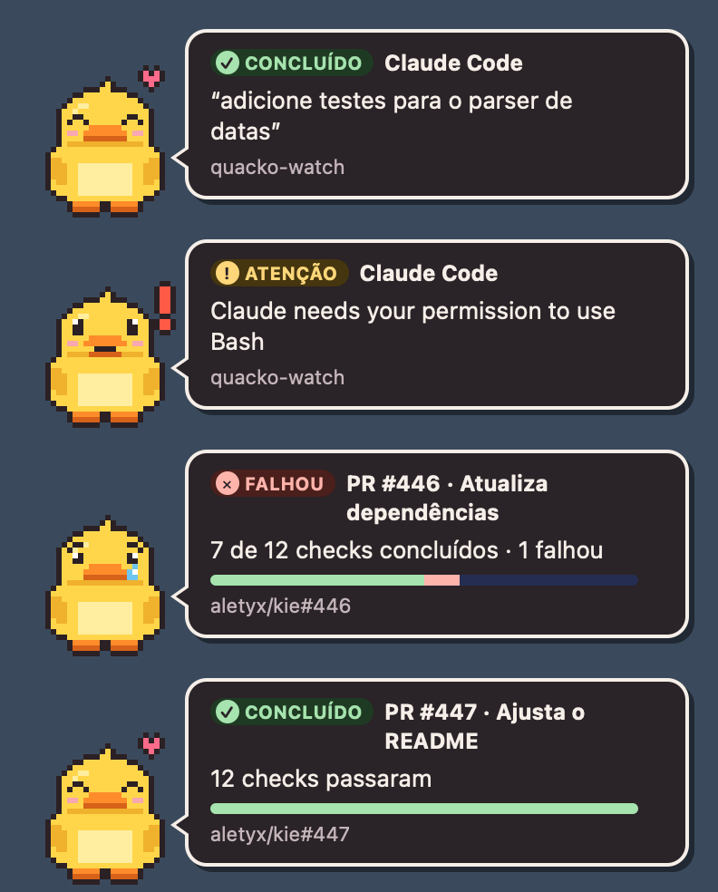
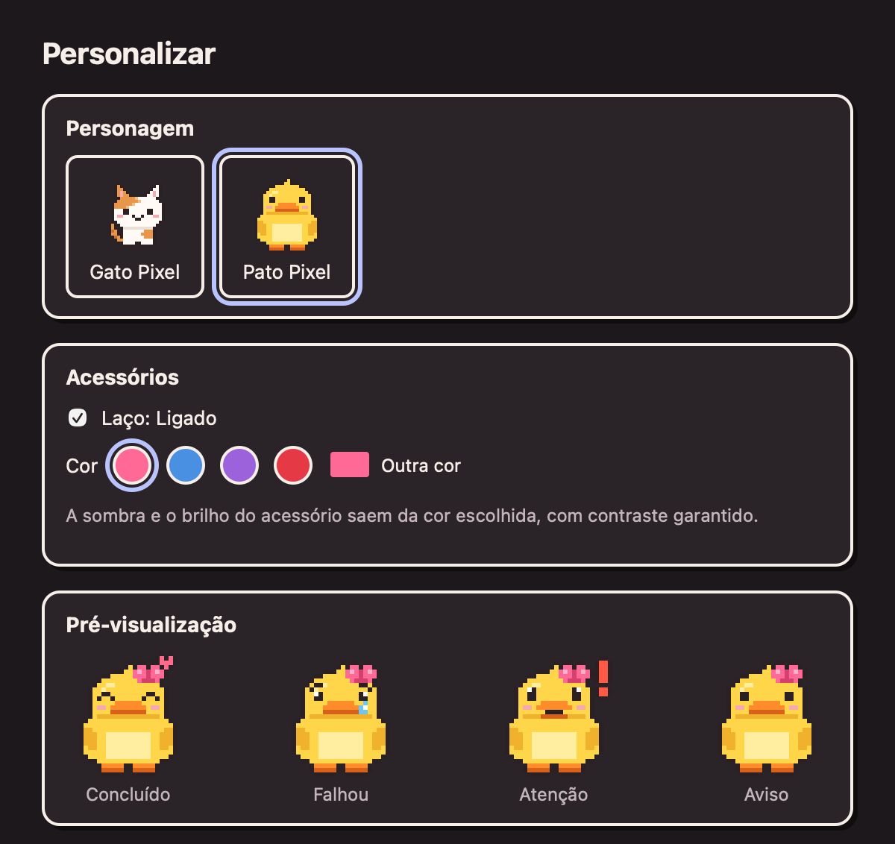

<p align="center">
  
</p>

<h1 align="center">Quacko</h1>

<p align="center">
  <b>Um patinho em pixel art que te avisa quando o trabalho termina.</b><br>
  Claude Code, Cursor e a CI dos seus PRs, num cartãozinho no canto da tela.
</p>

<p align="center">
  
  
  
  
</p>

<p align="center">
  
</p>

O pato aparece no canto da tela quando algo termina: o Claude Code ou o Cursor acabou de responder (ou precisa de você), ou a CI de um PR passou ou falhou. Clicar no cartão abre o PR. Ele fica só na barra de menus, não rouba o foco de onde você está digitando e funciona offline: tudo acontece no seu computador.

| | Estado | Quando |
|:-:|---|---|
|  | ✓ **Concluído** | o agente terminou, a CI passou |
|  | ✕ **Falhou** | a CI falhou, o agente parou com erro |
|  | ! **Atenção** | o agente precisa de permissão ou de uma resposta |
|  | i **Aviso** | qualquer outro aviso |

**Personagens:** o **Pato Pixel** é o padrão em instalações novas; o **Gato Pixel** continua disponível (campo `character` na config: `pato-pixel` ou `gato-pixel`). Sem escolha explícita, vale o pato.

**Acessórios (opcional):** no menu do pato → **Personalizar…** dá para trocar o personagem e ligar o **laço**, com cores prontas (rosa, azul, roxo, vermelho) ou qualquer outra; a sombra e o brilho saem da cor escolhida, com contraste garantido, e a pré-visualização mostra os 4 estados na hora.

<p align="center">
  
</p>
 Um acessório é só dado: um `accessory.json` e um sprite por estado com a mesma grade do personagem. A pasta `~/.config/quacko/accessories/` fica pronta para importar outros no futuro; a importação confere tamanhos, extensões, PNG de verdade, links e caminhos com `..` (zip slip).

## Instalar (macOS 11+, Apple Silicon e Intel)

Baixe o `Quacko_<versão>_universal.dmg` da página de Releases do repositório (quando houver) ou gere a partir do código (veja [Desenvolver](#desenvolver)). O `.dmg` universal funciona em Macs com Apple Silicon e com Intel.

1. Abra o `.dmg` e arraste o **Quacko.app** para **Aplicativos**.
2. O build não é assinado pela Apple, então o macOS bloqueia a primeira abertura quando o `.dmg` veio de um download. Libere de um destes jeitos:
   - abra o Quacko, vá em **Ajustes do Sistema → Privacidade e Segurança**, encontre o aviso sobre o Quacko no fim da página e clique em **Abrir Mesmo Assim**; ou
   - no Terminal: `xattr -dr com.apple.quarantine /Applications/Quacko.app`
3. Depois disso ele abre como qualquer app. O patinho aparece na barra de menus (não no Dock).

No menu do pato: **Testar notificação** mostra os 4 estados. Marque **Iniciar com o login** para ele abrir sozinho.

## Conectar ao Claude Code, ao Cursor e aos PRs

Pelo menu do pato, em **Conectar**:

- **Claude Code**: instala o script de aviso e liga os hooks em `~/.claude/settings.json`. A marca (✓) mostra que está conectado; clique de novo para desconectar. Vale a partir da próxima sessão do Claude Code.
- **Cursor**: o mesmo em `~/.cursor/hooks.json` (só aparece ativo se o Cursor estiver instalado).
- **GitHub (PRs)**: o app acompanha **todos os seus PRs abertos** sozinho e avisa quando a CI de cada um passa ou falha (check runs e status de commit, incluindo Jenkins). Consulta a cada 30 s enquanto algum PR está rodando e a cada 3 min quando tudo terminou; um PR que já tinha terminado quando o app abriu não avisa, e um push novo reinicia o acompanhamento. Login, nesta ordem: **login com código** do GitHub App do Quacko (botão Entrar na tela de boas-vindas; o token fica no Keychain e é renovado sozinho a cada 8 h por até 6 meses) ou o [GitHub CLI](https://cli.github.com) já logado (`gh auth login`), que o app encontra sozinho. O login com código só aparece quando o app conhece o **Client ID** do GitHub App: `"github_client_id": "Iv23li…"` em `~/.config/quacko/config.json` ou a variável `QUACKO_GITHUB_CLIENT_ID`. Com GitHub App, o Quacko só enxerga os repositórios onde o app foi instalado (em organizações, um dono aprova uma vez).
- **Instalar comando prwatch (PRs)**: cria o comando `prwatch` em `~/.local/bin`.

O app faz backup do arquivo antes de mexer (`settings.json.quacko-backup-<data>`), mantém os outros hooks e configurações como estavam e não duplica nada se você conectar duas vezes. Se o arquivo for gerenciado pelo Nix, somente leitura ou tiver comentários, ele não mexe: copia o trecho para a área de transferência e avisa onde colar. O resultado aparece no próprio cartão do pato.

Quem tem o código também pode instalar pelo terminal, com `scripts/install.sh` (copia os scripts e mostra os trechos de configuração, sem editar nada).

O que cada integração faz:

- **Claude Code** (`~/.claude/settings.json`): hooks `UserPromptSubmit`, `Stop` e `Notification` chamando `notify.sh --from claude`. O cartão mostra o pedido que o Claude terminou de responder e o projeto. Hooks antigos no formato `notify.sh <som>` continuam funcionando e já mostram o pato.
- **Cursor** (`~/.cursor/hooks.json`): `beforeSubmitPrompt` e `stop` chamando `notify.sh --from cursor`.
- **PRs**: `prwatch 1234` (ou a URL do PR, ou nada para o PR da branch atual) espera a CI terminar e avisa com o número, o título e o repositório do PR. Precisa do [GitHub CLI](https://cli.github.com) logado.

Além do aviso, o `notify.sh` pausa a mídia e toca um som:

- **Spotify**: pausado por AppleScript, sem instalar nada.
- **YouTube e outros players** (a "mídia em reprodução" do sistema): pelo [`nowplaying-cli`](https://github.com/kirtan-shah/nowplaying-cli), opcional (`brew install nowplaying-cli`). Se ele faltar e algum agente estiver conectado, o app avisa uma vez.
- Por que não é o próprio app que pausa: desde o macOS 15.4 a Apple bloqueou o framework de "mídia em reprodução" (MediaRemote) para apps que não são dela. Testado no macOS 26.5.2: o mesmo código lê a mídia quando roda num programa da Apple e recebe `nil` num app como o Quacko. O `nowplaying-cli` contorna isso carregando uma biblioteca dentro de um programa da Apple; o Quacko não copia esse contorno. Ele sempre sai com código 0 e em poucos milissegundos: com o app fechado, só não aparece o pato.

Qualquer outro script pode avisar o Quacko:

```bash
curl -s -X POST localhost:4747/notify -H 'Content-Type: application/json' \
  -d '{"source":"custom","status":"ok","title":"Backup","message":"Backup concluído","project":"servidor"}'
```

Campos: `source` (`agent`, `claude`, `ci`, `custom`), `status` (`ok`, `fail`, `attention`, `info`) e, opcionais, `message` (até 140 caracteres), `title` (60), `project` (80), `url` (só `http`/`https`) e `ttl_ms` (2000 a 30000). Contrato completo na seção 5 do [quacko-spec.md](quacko-spec.md).

## Configuração

Arquivo `~/.config/quacko/config.json`, criado no primeiro uso. O menu altera a maioria dos campos:

| Campo | Valores | Padrão |
|---|---|---|
| `lang` | `auto` (idioma do sistema), `pt-BR`, `en` | `auto` |
| `dnd` | Não perturbar | `false` |
| `autostart` | Iniciar com o login | `false` |
| `port` | porta local (a variável `QUACKO_PORT` vence) | `4747` |
| `max_cards` | cartões na tela ao mesmo tempo, 1 a 3 | `3` |
| `pixel_size` | tamanho do pixel do personagem: 3, 4, 5, 6 ou 8 | `3` |
| `github` | monitor de PRs ligado (menu Conectar → GitHub) | `false` |
| `github_client_id` | Client ID do GitHub App para o login com código | vazio |
| `onboarded` | a tela de boas-vindas já foi vista | `false` |
| `character` | personagem: `pato-pixel` ou `gato-pixel` | `pato-pixel` |
| `accessory_enabled` | acessório (laço) ligado | `false` |
| `accessory_color` | cor principal do acessório, `#rrggbb` | `#ff6996` |

Valores inválidos voltam ao padrão sem travar o app. Mudanças feitas direto no arquivo valem ao reabrir o app.

## Desenvolver

Requisitos: macOS 11+, [Rust](https://rustup.rs) (estável), Node.js 20+ e as ferramentas de linha de comando do Xcode (`xcode-select --install`).

```bash
npm install
npm run tauri dev        # app em modo de desenvolvimento
scripts/demo.sh          # dispara 4 avisos de exemplo

npm test                 # testes do frontend (Vitest)
npm run typecheck
(cd src-tauri && cargo test && cargo clippy --all-targets -- -D warnings)
bash scripts/tests/notify.test.sh
bash scripts/tests/prwatch.test.sh

npm run build:mac        # .app e .dmg para este Mac, em src-tauri/target.noindex/release/bundle/
npm run build:mac:universal  # .dmg universal (Apple Silicon + Intel), em src-tauri/target.noindex/universal-apple-darwin/release/bundle/dmg/
```

As imagens deste README ficam em `docs/images/`. Para refazer as fotos com o `npx vite` rodando: `swift tools/snapshot.swift "http://localhost:1420/preview.html?ids=4,5,2,3" docs/images/cartoes.png 396 492 2.5` (cartões) e `swift tools/snapshot.swift "http://localhost:1420/preview.html?view=customize" docs/images/personalizar.png 600 566 2.5` (Personalizar).

O build universal usa o toolchain da Apple num ambiente limpo (`scripts/build-universal.sh`): dentro de um shell do Nix o compilador C padrão só gera arm64 e a parte Intel falharia. No GitHub Actions isso não acontece.

O `build:mac` roda o `tauri build` com dois ajustes para o macOS: põe as ferramentas do Xcode no **fim** do `PATH` (sem isso o `.dmg` pode falhar com `tool 'SetFile' not found` quando o terminal usa um SDK do Nix; no começo do `PATH` elas trocam o compilador e o link falha) e, no fim, tira a cópia de build do registro de apps do sistema (`scripts/after-build.sh`), para não aparecer um segundo "Quacko" na lista de apps. A pasta de build se chama `target.noindex` pelo mesmo motivo: o Spotlight não indexa pastas com esse sufixo.

Estrutura: `src/` é o overlay (React + TypeScript), `src-tauri/` é o app (Rust: servidor local, janela, menu, config), `scripts/` são as integrações e `tools/` tem os geradores dos personagens e do ícone (como regenerar: seção 8 do [quacko-spec.md](quacko-spec.md)). As especificações ficam em [quacko-spec.md](quacko-spec.md) (v1), [quacko-spec-v2-produto.md](quacko-spec-v2-produto.md) e [quacko-spec-personalizacao.md](quacko-spec-personalizacao.md).

## Releases

O workflow [`.github/workflows/release-macos.yml`](.github/workflows/release-macos.yml) roda só quando uma tag `v*` é enviada:

```bash
git tag v0.1.0 && git push origin v0.1.0
```

Ele roda os testes, gera o `.dmg` universal e cria um release em **rascunho**; o release só fica público quando alguém clicar em **Publish release** no GitHub.

**Assinatura e notarização** (opcional, desligada por padrão). Sem ela, quem baixar o app vê o aviso do macOS na primeira abertura e libera em **Ajustes do Sistema → Privacidade e Segurança → Abrir Mesmo Assim** (ou com `xattr -dr com.apple.quarantine /Applications/Quacko.app`), como descrito em [Instalar](#instalar-macos-11-apple-silicon-e-intel). Para assinar e notarizar, é preciso uma conta Apple Developer (cerca de US$ 99/ano) e:

1. Variável do repositório (Settings → Secrets and variables → Actions → Variables): `MACOS_SIGNING` = `true`.
2. Segredos do repositório:
   - `APPLE_CERTIFICATE`: o certificado **Developer ID Application** exportado como `.p12`, em base64 (`base64 -i certificado.p12 | pbcopy`).
   - `APPLE_CERTIFICATE_PASSWORD`: a senha do `.p12`.
   - `APPLE_SIGNING_IDENTITY`: o nome do certificado, ex.: `Developer ID Application: Nome (TEAMID)`.
   - `APPLE_ID`, `APPLE_PASSWORD` (senha de app gerada em appleid.apple.com) e `APPLE_TEAM_ID`: para a notarização.

Nunca coloque certificados, senhas ou tokens no repositório.

## Decisões e limitações

- **Porta fixa `4747`** em `127.0.0.1`: simples para os scripts. Troque pela config ou por `QUACKO_PORT` se houver conflito; com a porta ocupada, o menu mostra o erro e o app continua aberto.
- **Segurança local**: o servidor recusa pedidos de páginas web (cabeçalho `Origin`), `Host` que não seja do próprio computador, corpo acima de 4 KB e mais de 10 pedidos por segundo. Todo texto é mostrado como texto, nunca como HTML.
- **Foco**: o cartão aparece sem tirar o foco do app em uso. O mouse é acompanhado pelo próprio app (o WebKit não entrega "hover" a uma janela sem foco), e os cliques atravessam a área transparente da janela.
- **Spaces e tela cheia**: a janela pede para aparecer em todos os Spaces e sobre apps em tela cheia (comportamento nativo do macOS configurado pelo app). Se em alguma versão do macOS ela não aparecer sobre tela cheia, é uma limitação do sistema.
- **`nowplaying-cli`** pode não funcionar em versões recentes do macOS para mídia de navegador; é independente do app e falha em silêncio. O Spotify é pausado por AppleScript.
- **Build não assinado pela Apple** (assinatura ad-hoc, sem custo): por isso o aviso na primeira abertura. Assinar e notarizar exige conta Apple Developer.
- **`macOSPrivateApi`** (necessário para a janela transparente) impede publicar na Mac App Store; a distribuição é direta.
- **"Iniciar com o login" no modo de desenvolvimento** registra o binário de desenvolvimento, que não abre sozinho sem o `npm run tauri dev`. Ative pelo app instalado.
- **Windows e Linux**: ainda não. O código é portável, mas a janela sem foco, o ícone da bandeja e os scripts precisam de versões próprias (planejado na spec v2).

## Privacidade

Nada sai do seu computador. O app só escuta em `127.0.0.1`, não tem telemetria e não registra o texto das mensagens nos logs. O pedido que você enviou ao Claude ou ao Cursor fica guardado em `~/.cache/quacko/` (pasta só sua) entre o envio e a resposta, e é apagado em seguida.

## Licença

A definir. Os personagens Pato Pixel e Gato Pixel são originais e estão sob CC0-1.0.
